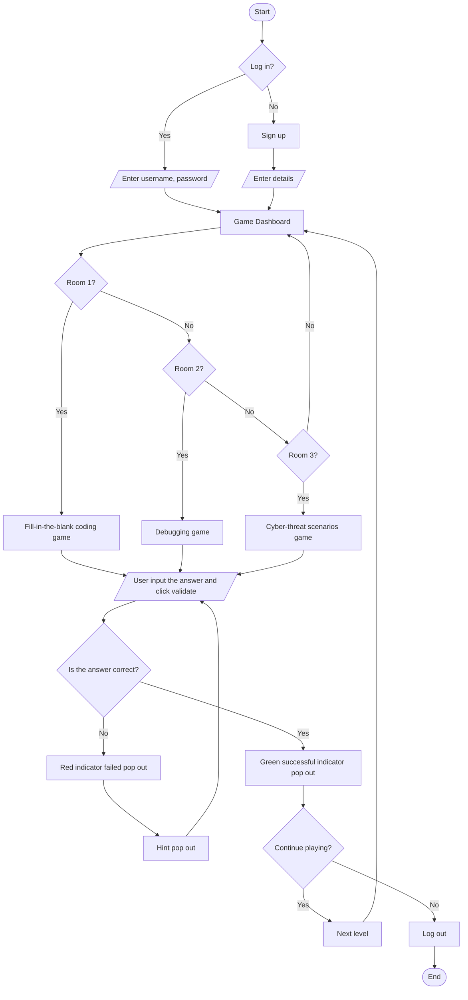

**3.1 Concepts**

Educational Gamification combined with a Web-Based Execution Decision Support System (DSS) is a learning module or paradigm that combines gamified behavioural mechanics, for example sequential learning, real-time feedback loops, scoring marks and diagnostic hints directly into web-based execution platform. Rather than depending on passive reading materials, this technology evaluates player’s knowledge by the dashboard.

The core technology functions on a continuous Input-Evaluate-Feedback-Reward (IEFR) lifecycle:
i.	Input: Player inspect the wrong code given or visual threat scenarios.

ii.	Evaluate: Client-side deterministic engine parses the player’s answer against expected pattern tokens.

iii.	Feedback: The system instantly triggers visual indicators (color-coded highlighting, line error markers or diagnostic hint prompts)

iv.	Reward & Progression: Validated answer will be an increment for player’s scores to unlock the next level in the game.

